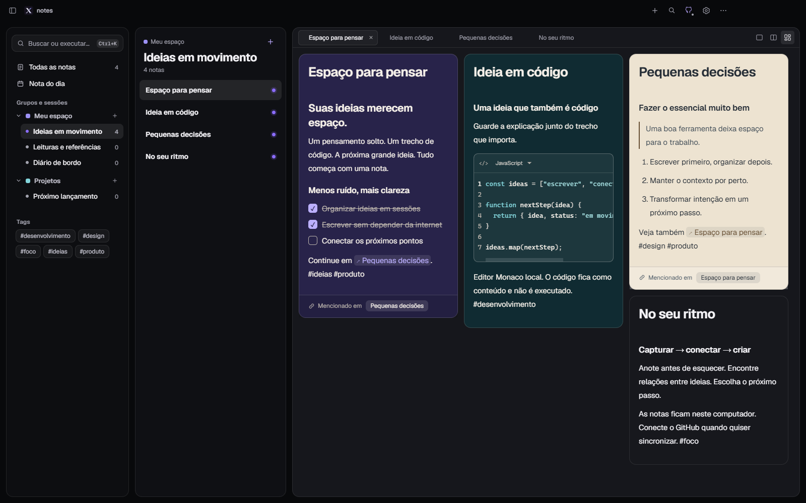
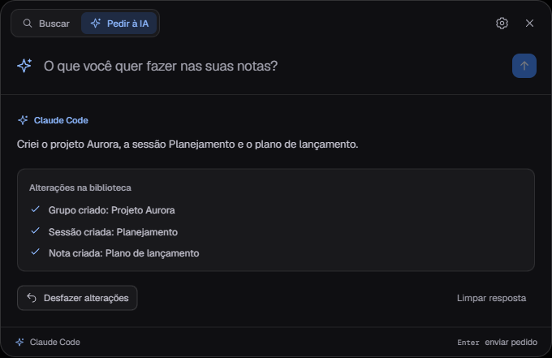

<p align="center"></p>

# notes

**Room to think. A visual, local-first notes app for Windows.**

Created and maintained by **[Bruno Brito](https://brunobrito.org)** · [LinkedIn](https://www.linkedin.com/in/brunosbrito/) · [Português](README.md)



Write visually, connect ideas and keep code alongside its context. Your library lives on your computer. Optional synchronization uses a private repository in your own GitHub account.

## What you can do

- Edit rich text, paste Markdown, and work with headings, tables, tasks and links.
- Keep editable Monaco code blocks with 84 languages and local workers. Code is stored as content and never executed.
- Organize groups, sessions, tags and linked notes. Open multiple tabs in single, side-by-side or masonry views.
- Use the central search box to create, edit and organize notes, groups and sessions through Codex CLI, Claude Code or an ACP v1 agent. Configure provider, agent, model and reasoning effort from the search settings shortcut, with a searchable model catalog loaded from the CLI.
- Choose 10 global themes, 20 note styles and two workspace appearances.
- Connect to Notion, review an inventory and coverage gaps before importing, or use full exports and Obsidian vaults while preserving source files. See the [migration guide](docs/IMPORTACAO_NOTION.md).
- Work offline, export ZIP backups and synchronize manually or daily with Git history and conflict review.
- Run a Windows x64 portable executable with Windows controls and keyboard-accessible custom UI.

## Get started

Check [Releases](https://github.com/xbrunots/xnotes/releases) for published builds. The executable is not checked into the repository. If no release is available, build it from source.

For development, use **Windows x64, Node.js 24 and Git**:

```powershell
git clone https://github.com/xbrunots/xnotes.git notes
cd notes
npm ci
npm start
```

You can dismiss the GitHub onboarding and use the app locally. `Ctrl+S` saves locally; `Ctrl+Shift+S` synchronizes. Typing, importing and closing do not upload your notes.

For AI, press **Ctrl+K**, select **Pedir à IA**, and click the settings icon. Use an existing installed/authenticated CLI; the process runs locally, while inference may use the provider's cloud. Validated actions save locally with stale-edit protection and undo for the latest AI batch. Configuration stays on the device, outside Git sync. See the [AI setup and integration contract](docs/IA_LOCAL.md) in Portuguese.

```powershell
npm run docs:check
npm test
npm run test:ui
npm run test:ai-ui
npm run dist
npm run test:portable
```

The deliverable is `portable/notes-1.0.0-Windows-x64-portable.exe`. No installer is generated. See the [development guide](docs/DESENVOLVIMENTO.md) for the complete validation sequence.

## Engineering you can inspect

Electron handles storage, credentials and Git operations through a narrow preload API. React, TipTap/ProseMirror and Monaco provide the editing experience. The renderer, fonts and editor workers ship locally.

The project includes recovery journals and checkpoints, immutable revisions, merge and stale-conflict guards, and tests against real Git with isolated local remotes. Private GitHub repositories are not end-to-end encryption. Backend authentication, downloads and scheduling use fixtures in QA; this does not certify every account or Windows configuration.

AI adapters return typed workspace actions instead of receiving direct access to your library files. The application validates the complete batch and checks its base again inside the storage queue. CLI/ACP tests and the Electron AI flow use controlled providers without real model calls. A user-selected ACP executable remains a trusted local program; the client protocol is not an operating-system sandbox.

## Built with AI assistance



notes is a portfolio project about taking a product direction through implementation, documentation and reproducible verification with AI assistance. Human direction and maintenance remain explicit. We do not claim a percentage of generated code, a complete prompt history or an external security audit.

Read the [AI development case study](docs/DESENVOLVIMENTO_COM_IA.md), [architecture](docs/ARQUITETURA.md), [specification](docs/ESPECIFICACAO.md), [decisions](docs/DECISOES.md) and [validation record](docs/VALIDACAO.md). Technical documents are currently written in Portuguese.

## Contribute and connect

Bug reports, documentation, accessibility and focused pull requests are welcome. Follow the [contributing guide](CONTRIBUTING.md), [code of conduct](CODE_OF_CONDUCT.md) and [security policy](SECURITY.md). AI-assisted contributions have the same review and validation requirements.

Explore more of my work at **[brunobrito.org](https://brunobrito.org)** or **[connect on LinkedIn](https://www.linkedin.com/in/brunosbrito/)**.

The project license is pending the maintainer's selection. See [third-party notices](THIRD_PARTY_NOTICES.md) for component credits.
