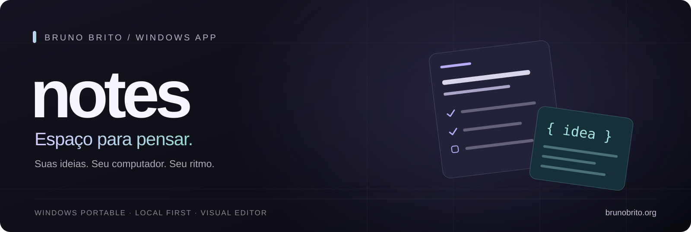
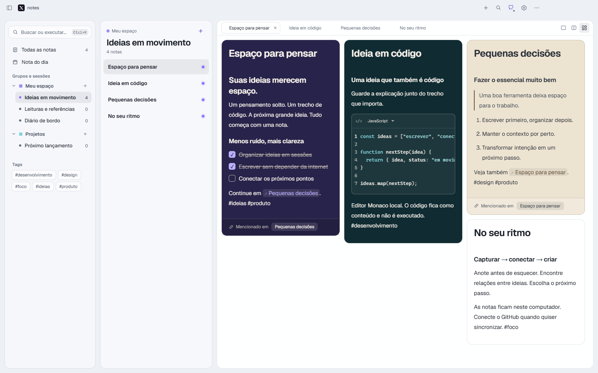

<p align="center">
  
</p>

<h1 align="center">notes</h1>



<p align="center">
  <strong>Um espaço visual para escrever, conectar ideias e guardar código.</strong><br>
  Feito para Windows. Seus dados ficam com você.
</p>

<p align="center">
  <a href="https://brunobrito.org"></a>
  <a href="https://www.linkedin.com/in/brunosbrito/"></a>
  <a href="docs/DESENVOLVIMENTO.md"></a>
  <a href="docs/DESENVOLVIMENTO_COM_IA.md"></a>
</p>

<p align="center">
  <a href="#comece-aqui">Começar</a> ·
  <a href="docs/README.md">Documentação</a> ·
  <a href="docs/ARQUITETURA.md">Arquitetura</a> ·
  <a href="CONTRIBUTING.md">Contribuir</a> ·
  <a href="README.en.md">English</a>
</p>

---

## Ideias soltas. Contexto conectado.

**notes** reúne escrita, referências e trechos de código em um aplicativo desktop que funciona offline. Organize por grupos e sessões, conecte notas com links e escolha entre uma página em foco, editores lado a lado ou cartões em mosaico.

A sincronização é opcional e usa um repositório **privado na sua conta GitHub**. Escrever salva no computador; enviar para o GitHub é uma ação separada, manual ou diária.


<p align="center"><sub>Captura do Electron real, com conteúdo fictício. Os temas de cada nota acompanham seus controles e blocos de código.</sub></p>

## Feito para o fluxo de trabalho

| Recurso | O que você pode fazer |
| --- | --- |
| **Escrita visual** | Colar Markdown e editar títulos, listas, tarefas, tabelas e links diretamente na nota. |
| **Código com contexto** | Editar blocos Monaco com 84 linguagens, workers locais e conteúdo persistido. Código não é executado. |
| **Organização flexível** | Usar grupos, sessões, tags, links entre notas, abas e painéis redimensionáveis. |
| **IA pelo seu CLI** | Criar, editar e organizar notas, grupos e sessões pela busca central, com Codex CLI, Claude Code ou ACP e configuração de agente/esforço. |
| **Seu espaço, seu tema** | Escolher entre 10 temas globais, 20 estilos por nota e aparências Padrão ou Ilha. |
| **Dados locais** | Trabalhar sem conexão, manter anexos e exportar backups completos em ZIP. |
| **GitHub opcional** | Sincronizar com histórico Git, merge de alterações compatíveis e comparação Local/GitHub para conflitos. |
| **Migração com conferência** | Conectar ao Notion, conferir páginas, bancos e pendências antes de importar; também aceitar ZIPs e cofres Obsidian, preservando originais. |
| **Windows portable** | Abrir um único executável, com controles Windows, Snap e atalhos de teclado. |

<details>
<summary><strong>Veja também em tema claro</strong></summary>



</details>

## Comece aqui

**Quer usar o aplicativo?** O artefato final é `notes-1.0.0-Windows-x64-portable.exe`, gerado em `portable/`. Abra-o em uma pasta gravável; Node.js e Electron não são necessários no computador de uso.

O executável não faz parte do código versionado. Consulte [Releases](https://github.com/xbrunots/xnotes/releases) para verificar se há uma distribuição publicada. Se ainda não houver, gere o portable a partir do código abaixo. `portable/win-unpacked/notes.exe` é intermediário de build.

**Quer explorar o código?** Use Windows x64, Node.js 24 e Git:

```powershell
git clone https://github.com/xbrunots/xnotes.git notes
cd notes
npm ci
npm start
```

A primeira abertura oferece a conexão com GitHub. Você pode concluir o onboarding e trabalhar localmente. O [guia de uso](docs/GUIA.md) explica conexão, importação, atalhos e recuperação; o [guia de desenvolvimento](docs/DESENVOLVIMENTO.md) explica build e testes.

**Quer usar IA?** Clique na busca central ou pressione **Ctrl+K**, escolha **Pedir à IA** e use a engrenagem para configurar seu provedor. O notes executa um CLI já instalado e autenticado na máquina; o modelo pode usar a nuvem do provedor. Ações validadas são salvas localmente, com desfazer do último lote e proteção contra edições concorrentes. Veja [configuração, exemplos e contrato](docs/IA_LOCAL.md).


<p align="center"><sub>Interface Electron real com dados e provedor sintéticos de QA. <a href="docs/assets/notes-ai-settings.png">Ver configurações de provedor, agente e esforço.</a></sub></p>

## Por dentro da engenharia

O notes é um projeto de portfólio de **Bruno Brito**, desenvolvido com assistência de IA e foco em transformar direção de produto em software verificável.

| Decisão | Por que ela importa | Onde conferir |
| --- | --- | --- |
| **Renderer isolado do sistema** | A interface usa uma API de preload; arquivos, credenciais e processos ficam no processo principal. | [Arquitetura](docs/ARQUITETURA.md) |
| **Armazenamento com recuperação** | Journal, checkpoints e revisões ajudam a preservar trabalho após interrupções. | [Storage](desktop/storage.cjs) · [Testes](tests/storage.test.cjs) |
| **Conflito como parte do produto** | Versões incompatíveis exigem decisão; uma comparação desatualizada não pode sobrescrever alterações novas. | [GitHub Sync](desktop/github-sync.cjs) · [Especificação](docs/ESPECIFICACAO.md) |
| **Validação em camadas** | Testes de lógica, integração com Git, interface Electron e execução do portable têm responsabilidades distintas. | [Desenvolvimento](docs/DESENVOLVIMENTO.md) · [Validação](docs/VALIDACAO.md) |
| **Ações de IA com contrato** | O modelo devolve operações tipadas; o aplicativo valida o lote, confere sua base e grava pela mesma fila de persistência das notas. | [IA local](docs/IA_LOCAL.md) · [Testes](tests/ai-workspace.test.cjs) |
| **IA com critérios de aceite** | Regras explícitas, decisões documentadas e verificações reproduzíveis dão contexto à implementação assistida. | [Desenvolvimento com IA](docs/DESENVOLVIMENTO_COM_IA.md) |

**Stack:** Electron · React · TipTap/ProseMirror · Monaco Editor · esbuild · Node.js · Git · GitHub CLI · Playwright.

O renderer, as fontes e os workers do Monaco são distribuídos localmente. O aplicativo não depende de um serviço de backend do autor para editar notas. A sincronização conectada depende de GitHub e dos seus limites; repositório privado não equivale a criptografia ponta a ponta.

## Explore a documentação

| Para quem quer… | Leitura |
| --- | --- |
| Usar o aplicativo | [Guia de uso](docs/GUIA.md) |
| Entender a solução | [Arquitetura e modelo de dados](docs/ARQUITETURA.md) |
| Avaliar o escopo | [Especificação e critérios de aceite](docs/ESPECIFICACAO.md) |
| Migrar do Notion | [Conexão, cobertura, ZIP e retomada](docs/IMPORTACAO_NOTION.md) |
| Usar IA na biblioteca | [CLI/ACP, provedores, exemplos e privacidade](docs/IA_LOCAL.md) |
| Entender as escolhas | [Registro de decisões](docs/DECISOES.md) |
| Reproduzir build e QA | [Desenvolvimento](docs/DESENVOLVIMENTO.md) e [validação registrada](docs/VALIDACAO.md) |
| Avaliar o trabalho com IA | [Processo, limites e evidências](docs/DESENVOLVIMENTO_COM_IA.md) |
| Colaborar | [Contribuição](CONTRIBUTING.md), [conduta](CODE_OF_CONDUCT.md) e [segurança](SECURITY.md) |
| Propor o próximo passo | [Direções de evolução](docs/ROADMAP.md) |

## Construa junto

Encontrou um problema ou uma melhoria? [Abra uma issue](https://github.com/xbrunots/xnotes/issues/new/choose) com um cenário reproduzível ou envie uma contribuição seguindo o [guia](CONTRIBUTING.md). Documentação, acessibilidade e testes são boas formas de começar. Contribuições assistidas por IA são bem-vindas e seguem os mesmos critérios de qualidade.

## Sobre o autor

**Bruno Brito** — direção de produto e manutenção do notes.

Este repositório mostra meu trabalho na interseção entre produto, experiência desktop e desenvolvimento assistido por IA. A proposta é tornar o raciocínio técnico tão acessível quanto o código: explicar escolhas, preservar dados e dar meios para reproduzir a validação.

**[Conheça meu trabalho em brunobrito.org](https://brunobrito.org)** · **[Conecte-se comigo no LinkedIn](https://www.linkedin.com/in/brunosbrito/)**

## Licença e créditos

A licença do projeto será indicada aqui após a escolha do mantenedor. Dependências e fontes mantêm seus próprios termos; veja [créditos e componentes de terceiros](THIRD_PARTY_NOTICES.md).
