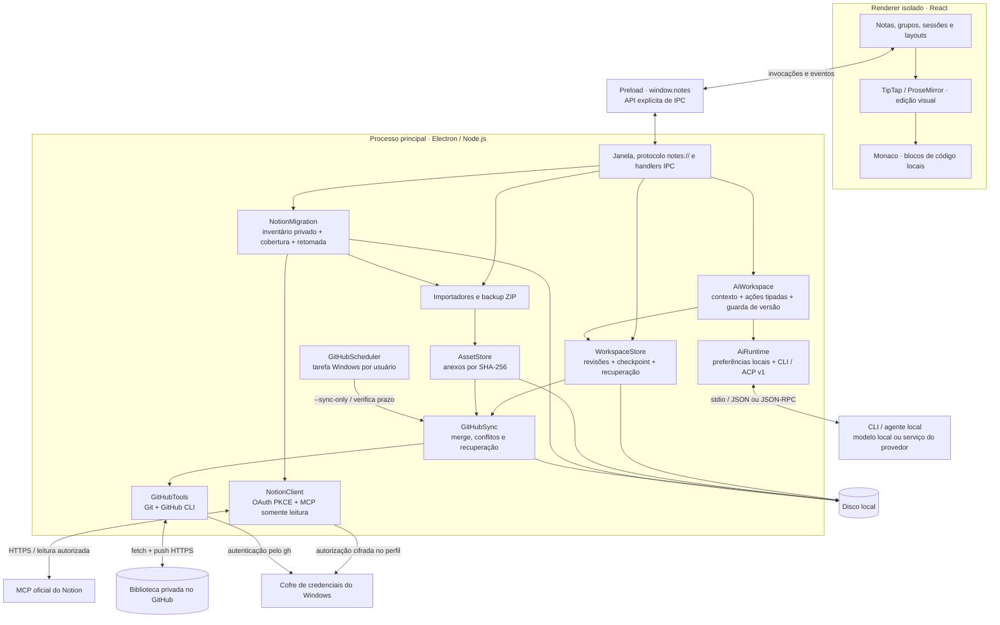

# Arquitetura de notes

Um aplicativo desktop para Windows que mantém uma biblioteca local completa e sincroniza versões pelo GitHub. A interface, o armazenamento e o transporte têm responsabilidades separadas; editar uma nota não depende de uma conexão com a internet.

[Visão geral](../README.md) · [Especificação](ESPECIFICACAO.md) · [Decisões](DECISOES.md)

## Visão do sistema



O diagrama mostra responsabilidades, não uma ordem fixa de chamadas. A API exposta pelo preload é a única ponte da interface para funções privilegiadas. Não há backend próprio necessário para escrever ou consultar notas.

## Mapa do código

| Área | Responsabilidade | Código |
| --- | --- | --- |
| Inicialização desktop | Perfil de dados, janela Windows, protocolo local e IPC | [main.cjs](../desktop/main.cjs), [preload.cjs](../desktop/preload.cjs) |
| Aplicação React | Estado da interface, autosave, navegação e comandos | [main.jsx](../src/main.jsx), [notes.jsx](../src/notes.jsx) |
| Editor visual | Schema, Markdown de compatibilidade, documento rico e histórico | [rich-editor.jsx](../src/rich-editor.jsx), [editor-extensions.js](../src/editor-extensions.js), [note-content.js](../src/note-content.js) |
| Código | Node view Monaco, linguagens e serialização preservando whitespace | [code-widget.jsx](../src/code-widget.jsx), [code-serialization.js](../src/code-serialization.js), [code-languages.js](../src/code-languages.js) |
| Layout | Reorganização, redimensionamento e geometria do mosaico | [organize-workspace.js](../src/organize-workspace.js), [resizable-panels.jsx](../src/resizable-panels.jsx), [masonry-layout.js](../src/masonry-layout.js) |
| Persistência | Validação JSON, relógios vetoriais, revisões e recuperação | [storage.cjs](../desktop/storage.cjs) |
| Arquivos | Anexos, importações Notion/Obsidian e backups | [assets.cjs](../desktop/assets.cjs), [importers.cjs](../desktop/importers.cjs), [backups.cjs](../desktop/backups.cjs) |
| Notion conectado | OAuth/PKCE, transporte MCP de leitura, inventário privado e conversão | [notion-client.cjs](../desktop/notion-client.cjs), [notion-migration.cjs](../desktop/notion-migration.cjs), [notion-content.cjs](../desktop/notion-content.cjs) |
| IA local | Busca e configuração, transporte CLI/ACP, contexto e operações validadas da biblioteca | [ai-ui.jsx](../src/ai-ui.jsx), [ai-runtime.cjs](../desktop/ai-runtime.cjs), [ai-workspace.cjs](../desktop/ai-workspace.cjs) |
| Sincronização | Coordenação, merge de entidades e arquivos, transporte Git | [github-sync.cjs](../desktop/github-sync.cjs), [github-merge.cjs](../desktop/github-merge.cjs), [github-repo.cjs](../desktop/github-repo.cjs) |
| Integração Windows | Ferramentas oficiais portáteis, login e tarefa agendada | [github-tools.cjs](../desktop/github-tools.cjs), [github-scheduler.cjs](../desktop/github-scheduler.cjs) |
| Build | Bundle local da interface, workers e portable x64 | [build.cjs](../scripts/build.cjs), [package-portable.cjs](../scripts/package-portable.cjs), [package.json](../package.json) |

## Modelo de dados

A interface trabalha com um snapshot JSON. `WorkspaceStore` o decompõe em entidades independentes para versionar alterações. O contrato efetivo está em `validateSnapshot`, `entitiesOf` e `validateRevision` de [storage.cjs](../desktop/storage.cjs).

| Elemento | Campos e significado |
| --- | --- |
| Snapshot | `groups`, `notes` e preferências na raiz. Campos JSON adicionais são preservados para compatibilidade. |
| Grupo | `id`, `name`, `sessions`; pode conter cor e outros metadados. |
| Sessão | `id`, `name`; fica dentro de um grupo no snapshot e é uma entidade própria no journal. |
| Nota | `id`, `s` (ID da sessão), `title`, `body`; pode incluir `tags`, `attachments`, `deletedAt`, `dailyKey`, `noteTheme` e `richText`. |
| Documento rico | `richText: { version: 1, source, doc }`; `doc` é o documento TipTap/ProseMirror e `source` identifica o corpo correspondente. |
| Anexo | Descritor com `hash`, `name`, `mime`, `relativePath`, `size`; os bytes ficam separados e são verificados por SHA-256. |
| Preferências | Cada chave da raiz fora de `groups`/`notes` vira uma entidade `pref`: por exemplo, tema, aparência, exibição, abas e dimensões. |
| Revisão | `schema`, `id`, `kind`, `key`, `device`, `clock`, `deleted`, `createdAt` e `value` quando não excluída. O ID é o hash do conteúdo canônico. |

O `body` mantém uma representação compatível com Markdown. O editor só usa `richText.doc` quando `richText.source === body`; caso contrário, reconstrói a visualização a partir do corpo. Assim, um documento rico antigo não encobre uma edição recebida de outro dispositivo. Propriedades importadas no frontmatter são separadas do texto editável e preservadas. Veja [note-content.js](../src/note-content.js) e [rich-editor.jsx](../src/rich-editor.jsx).

Os blocos de código pertencem ao documento visual como nós `codeBlock`, com texto e atributo de linguagem. Monaco edita esses nós; não é um ambiente para executar programas. Alterações locais participam do histórico do editor. Carregamento inicial e atualizações remotas usam `addToHistory: false` em [editor-content.js](../src/editor-content.js).

## Salvamento e recuperação local

1. Uma edição atualiza o estado React e agenda autosave local. `Ctrl+S` força a drenagem das alterações pendentes.
2. A interface envia o próximo snapshot e a base já reconhecida para `workspace:save`. Isso permite distinguir uma edição local de um snapshot antigo recebido enquanto o disco trabalhava.
3. `WorkspaceStore` serializa gravações, valida candidatos e limites antes de persistir e gera revisões apenas para alterações reais.
4. As revisões são imutáveis; o checkpoint reúne as versões atuais, inclusive marcadores de exclusão. A escrita usa arquivo temporário, `fsync` e renomeação. Eventos de mudança são emitidos depois da persistência.
5. Na abertura, o armazenamento verifica checkpoint, cópias e journal. Arquivos inválidos são preservados para recuperação. Se não houver estado recuperável, a abertura falha explicitamente em vez de substituir os dados pelo conteúdo inicial.

Relógios vetoriais representam causalidade por dispositivo; a detecção de concorrência não depende de relógios de parede sincronizados. Exclusões usam tombstones. Notas sem sessão disponível recebem um destino recuperável durante a projeção. Esses contratos possuem regressões em [storage.test.cjs](../tests/storage.test.cjs) e [renderer.test.cjs](../tests/renderer.test.cjs).

## Organização dos arquivos em execução

Quando a pasta do portable permite escrita, os diretórios ficam ao lado do executável:

```text
notes-data/                 # perfil e biblioteca local
  workspace.json           # checkpoint verificado
  workspace.json.bak*       # cópias de checkpoint
  revisions/               # revisões imutáveis
  assets/                  # bytes de anexos por hash
  recovery/                # evidência de arquivos locais inválidos
  github-*.json            # estado de conexão, conflitos e operação
  github-recovery/         # snapshots de sincronização interrompida
  notion-credentials.enc   # autorização cifrada pelo sistema operacional
  notion-import/           # inventários privados retomáveis e downloads
  ai/settings.json         # preferências de CLI/ACP deste dispositivo
notes-repository/          # clone Git da biblioteca
  .notes-repository.json   # marcador e identidade da biblioteca
  revisions/
  assets/chunks/
  assets/manifests/
notes-tools/               # Git e GitHub CLI portáteis, quando necessários
```

Se `notes-data` não puder ser criado junto do portable, [main.cjs](../desktop/main.cjs) usa a pasta de dados do aplicativo no perfil Windows. O diretório de ferramentas e o clone seguem a raiz de execução. Tokens não fazem parte dessas revisões ou dos descritores de anexos.

O cliente Notion não usa a sincronização GitHub nem recebe tokens no renderer. A leitura exige ação de conectar; o inventário é conferido antes do comando de importar. A aplicação usa o mesmo `WorkspaceStore`, com marcador de plano para repetição segura. Detalhes e limites estão em [Migração do Notion](IMPORTACAO_NOTION.md).

## IA local e ações da biblioteca

A busca central alterna consulta local e pedidos à IA. A inicialização do aplicativo e a busca carregam somente status e preferências. A engrenagem abre a seção de IA das Configurações, com provedor, agente/modo, modelo pesquisável, esforço e opções avançadas. Entrar nessa seção ou trocar de provedor consulta automaticamente os metadados dos modelos, sem enviar notas nem gerar conteúdo. Preferências de execução ficam em `ai/settings.json` no perfil do dispositivo, fora do snapshot e do Git; a autenticação permanece no CLI.

`AiRuntime` adapta Codex CLI, Claude Code e ACP v1 por stdio, sem shell e sem usar o perfil da biblioteca ou o clone Git como diretório de trabalho. A descoberta valida o rascunho atual sem salvá-lo: usa `--version` e os catálogos nativos (`model/list` do Codex e inicialização de controle do Claude); no ACP, negocia a sessão, aplica agente/modelo e consulta as opções anunciadas. Nenhum desses caminhos envia prompt ou inicia login. Falhas preservam o catálogo anterior com aviso; respostas de configurações já alteradas são descartadas pela interface. O modelo selecionado limita os esforços oferecidos. A execução tem limites de duração e saída, cancelamento dos processos próprios e diagnóstico reduzido. O processo é local; a inferência pode depender da nuvem do provedor.

`AiWorkspace` constrói um manifesto de grupos, sessões e notas, inclui corpos relevantes e permite leituras adicionais limitadas. A resposta deve conter mensagem, IDs de leitura ou ações tipadas. O modelo não recebe uma API genérica de shell e não substitui o snapshot completo. Ações e referências são validadas antes de gravar; edição de corpo exige leitura prévia. Alterar `body` invalida o documento rico antigo, mantendo a coerência do editor e os demais metadados.

A interface drena o autosave antes da consulta e da aplicação. O motor compara a base do pedido com o estado atual, valida o lote e repete a guarda dentro da fila do `WorkspaceStore`. Assim, uma edição recebida ou digitada enquanto a resposta chegava não é sobrescrita por uma ação obsoleta. A gravação local não dispara sync. O último lote mantém em memória um registro de desfazer limitado às entidades alteradas; a reversão também recusa alterações posteriores incompatíveis.

Pedidos e respostas mantêm um contexto curto de seguimento em memória, limpo por **Limpar resposta** ou ao encerrar o aplicativo. Os adaptadores nativos usam sessões efêmeras; retenção própria do agente ACP depende dele. O cliente ACP não fornece arquivos ou terminal, mas um executável escolhido pelo usuário continua tendo as permissões normais desse usuário. O [contrato de IA local](IA_LOCAL.md) detalha operações, contexto, limites e testes.

## Sincronização GitHub

O onboarding prepara ferramentas somente após a ação de conectar, autentica pelo GitHub CLI e cria ou adota uma biblioteca privada com marcador válido. Colisões com repositórios públicos, não marcados ou incompatíveis preservam o repositório existente e levam à escolha de outro nome. A implementação está em [github-sync.cjs](../desktop/github-sync.cjs).

Salvar pode exportar revisões e anexos para o clone **local**; não faz `fetch`, commit ou push. A sincronização de rede ocorre pelo comando explícito ou quando o prazo automático vence. O último sucesso e o próximo prazo de 24 horas são persistidos. Inicialização, retomada da sessão e a tarefa Windows verificam esse prazo; foco, importação e fechamento não são gatilhos de envio.

O ciclo de rede verifica a origem de fetch e push, recebe a árvore remota, valida revisões e anexos, planeja o merge, preserva snapshots/stash, grava o resultado, cria commit e faz push normal. Campos independentes e alterações textuais compatíveis podem ser combinados. Conflitos incompatíveis abrem uma comparação Local/GitHub e aguardam uma escolha, com opção de manter ambas quando aplicável. A resolução é recusada se revisões, arquivos ou commit remoto mudaram desde a comparação.

O sucesso depende de push confirmado; versões pendentes e dados de recuperação não são descartados por uma falha de rede. Não há force-push nem reset destrutivo. O merge preserva a ancestralidade Git, mas combina o conteúdo por um plano explícito de entidades e arquivos; não depende de aceitar cegamente a árvore de uma das pontas. Veja [github-sync.test.cjs](../tests/github-sync.test.cjs).

## Limites de confiança

| Fronteira | Controles implementados | Limite prático |
| --- | --- | --- |
| Renderer → sistema | `contextIsolation: true`, `nodeIntegration: false`, sandbox e API congelada `window.notes`; handlers verificam origem `notes://app/` | A API IPC continua privilegiada: novos handlers precisam validar origem, tipos e autorização da operação. |
| Conteúdo → navegador | [CSP](../src/index.html) com scripts/workers locais, `connect-src 'none'`, `object-src 'none'`, navegação externa bloqueada e novas janelas negadas | Estilos inline são permitidos para a interface. A CSP do renderer não limita a rede do processo principal. |
| Anexos → interface | Hash conhecido da biblioteca, verificação dos bytes, `nosniff` e CSP restrita; imagens renderizadas apenas de tipos permitidos | Um hash confirma integridade, não a confiabilidade do arquivo. Abrir um arquivo exportado usa ferramentas externas ao aplicativo. |
| Importação/remoto → disco | Validação de caminhos, rejeição de links/submódulos, limites de tamanho, integridade e processamento antes de aplicar o estado | Não há promessa de conversão perfeita para qualquer formato externo; originais são preservados pelos importadores. |
| Git → processos | Executáveis com caminhos verificados, `shell: false`, ambiente/configuração restritos, hooks/filtros desabilitados e saída limitada | Git e GitHub CLI são dependências externas. Os testes simulam instalação/login; não demonstram disponibilidade de serviços reais. |
| IA → biblioteca | Operações tipadas, conteúdo lido antes de editar, validação integral e guarda de versão dentro da fila de gravação | A qualidade do texto depende do modelo; a aplicação só aceita o subconjunto previsto no contrato. |
| Cliente → agente CLI/ACP | Processo sem shell, diretório temporário, ferramentas nativas desabilitadas, sem capacidades de arquivo/terminal no cliente ACP, limites e cancelamento | O CLI pode usar a nuvem. Um agente ACP continua sendo um programa local confiado pelo usuário; não há sandbox do sistema operacional criada pelo notes. |
| Autenticação → UI | GitHub CLI gerencia credenciais no cofre do Windows; status reduzido sem token e recusa de fallback em texto puro | A biblioteca Git não implementa criptografia ponta a ponta. Repositório privado e hashes não substituem criptografia. |
| Tarefa Windows → execução | Usuário logado, menor privilégio e verificação de ownership antes de modificar/remover tarefa | A sincronização agendada depende da sessão e das permissões do Windows. Falhas são apresentadas como estado, sem impedir edição local. |

Os limites atuais incluem revisões de até 64 MiB, checkpoint de até 512 MiB, anexos de até 256 MiB e blobs Git de até 100 MiB. Anexos são divididos em chunks de 32 MiB no repositório. Importação e backup têm limites próprios em [importers.cjs](../desktop/importers.cjs) e [backups.cjs](../desktop/backups.cjs); esses limites não são metas de desempenho.

## Build e legado

Fontes, ícones, Monaco e cinco workers são empacotados localmente; a edição não exige CDN. `scripts/import-reference.cjs` deriva a base visual e o conteúdo inicial de `Notas.html`. Ajustes desse material pertencem ao gerador; extensões funcionais ficam em `src/notes.jsx` e módulos associados.

O transporte Google Drive é legado de código-fonte e possui testes de regressão próprios. Ele não é o provedor usado por `main.cjs`; [package.json](../package.json) exclui `desktop/drive-*.cjs`, `desktop/cloud-sync.cjs` e a configuração Google do aplicativo distribuído. Testes legados não devem ser apresentados como evidência de execução do fluxo GitHub.

Os documentos descrevem a implementação inspecionável. Para critérios e testes correspondentes, consulte a [especificação](ESPECIFICACAO.md); para consequências das escolhas, consulte as [decisões](DECISOES.md). A presença de um teste não afirma que ele foi executado em um determinado commit.
