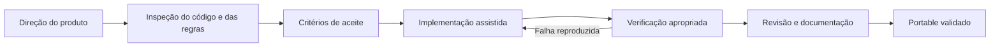

# Desenvolvimento do notes com IA

O notes é um projeto de [Bruno Brito](https://brunobrito.org), construído com assistência de IA. A direção de produto e a responsabilidade pela publicação pertencem ao mantenedor. Agentes ajudam a inspecionar, implementar, documentar e verificar mudanças dentro de instruções explícitas.

Este documento apresenta o processo e as evidências disponíveis no repositório. Não existe aqui um histórico integral de prompts ou uma medição da parcela de código gerada por IA.

O aplicativo também oferece uma funcionalidade de IA para seus usuários: a [busca central com CLI/ACP](IA_LOCAL.md). Seu contrato de execução, contexto e ações da biblioteca está documentado separadamente; a edição visual continua disponível sem provedor de IA.

## Da intenção ao contrato

O ponto de partida visual é [Notas.html](../Notas.html). A evolução para um aplicativo desktop introduz persistência, importação, edição visual, gerenciamento de janelas e sincronização. As regras de trabalho estão em [AGENTS.md](../AGENTS.md): marca, fidelidade visual, preservação de dados, limites da automação e critérios da entrega portable.

Essas regras tornam pedidos de produto verificáveis. Alguns exemplos:

| Intenção de produto | Contrato verificável | Evidência no repositório |
| --- | --- | --- |
| Escrever sem distração | Um editor visual por nota; reorganização não duplica o corpo. | [UI smoke](../tests/ui-smoke.cjs), [layout](../tests/layout-ui.cjs). |
| Guardar código sem perder conteúdo | Linguagem, TABs e linhas vazias sobrevivem à serialização e ao reinício. | [Conteúdo](../tests/note-content.test.cjs), [histórico](../tests/editor-history.test.cjs), [Monaco no Electron](../tests/code-widget-ui.cjs). |
| Ter controle sobre envio | Ctrl+S salva localmente; digitar/importar/focar/fechar não inicia upload. | [Integração UI](../tests/ui-smoke.cjs), [GitHub Sync](../tests/github-sync.test.cjs). |
| Preservar trabalho em conflito | A decisão precisa corresponder à comparação atual; alterações concorrentes não são descartadas silenciosamente. | [Sync](../tests/github-sync.test.cjs), [cancelamento](../tests/github-sync-cancel.test.cjs), [UI GitHub](../tests/github-ui.cjs). |
| Migrar com conferência | Autenticação oficial, inventário retomável e aviso de lacunas antes de aplicar, sem afirmar acesso a páginas fora das permissões. | [Contrato da migração](IMPORTACAO_NOTION.md), [cliente](../tests/notion-client.test.cjs), [motor](../tests/notion-migration.test.cjs), [Electron](../tests/notion-migration-ui.cjs). |
| Usar IA nas notas com controle | Provedor local configurável, ações tipadas e guarda contra resposta obsoleta, com desfazer que conserva edições posteriores. | [Contrato da IA](IA_LOCAL.md), [runtime](../tests/ai-runtime.test.cjs), [ações](../tests/ai-workspace.test.cjs), [Electron](../tests/ai-ui.cjs). |
| Entregar algo executável | Gerar e abrir o portable real, salvar, fechar e reabrir um perfil isolado. | [Smoke do portable](../tests/portable-smoke.cjs). |

## Responsabilidades explícitas

**Direção humana.** Bruno define o propósito do produto, suas preferências de interação, a identidade visual e as condições de entrega. A manutenção, priorização e aceitação das contribuições continuam sob sua responsabilidade.

**Assistência de IA.** O trabalho é orientado por arquivos reais, instruções locais e escopos definidos. Na preparação desta documentação, um agente ficou responsável pela arquitetura, especificação e decisões; o agente principal cuidou da apresentação, guias, integração e verificação final. O paralelismo foi limitado a responsabilidades separadas.

**Evidência.** O texto gerado precisa corresponder ao código. Um teste escrito não prova que passou. Uma captura precisa vir da aplicação. Uma promessa de preservação de dados precisa apontar para contratos e verificações que a sustentem.

## Ciclo de trabalho reproduzível

1. Ler as instruções e identificar os módulos envolvidos antes de editar.
2. Traduzir a mudança em comportamento esperado, incluindo situações de falha.
3. Fazer uma alteração coerente, preservando convenções e dados.
4. Executar verificações pertinentes: lógica, integração Git, Electron e artefato quando aplicável.
5. Registrar o que foi executado e as limitações. Atualizar os documentos afetados.
6. Só apresentar o portable como validado após executar o teste no arquivo final.

Os comandos estão no [guia de desenvolvimento](DESENVOLVIMENTO.md). Os critérios do produto estão na [especificação](ESPECIFICACAO.md), e os resultados registrados ficam em [validação](VALIDACAO.md).

## Limites do que podemos afirmar

- Há assistência de IA no desenvolvimento e na documentação. Não há base para publicar percentuais de autoria, produtividade ou economia de tempo.
- Testes exercitam cenários definidos; não representam certificação de segurança nem garantia de ausência de falhas.
- Fluxos Git usam remotos bare locais em QA. Login, instalação de ferramentas e tarefa Windows usam fixtures, sem operar a conta ou o sistema real do usuário.
- Testes da IA usam transportes e provedores sintéticos; não medem a qualidade de um modelo real nem comprovam acesso de uma conta a todos os modelos, agentes e esforços.
- O registro histórico de validação contém resultados de rodadas anteriores, identificados como tais. A existência de CI não implica uma execução remota aprovada.
- O logo aprovado foi produzido com o imagegen integrado, conforme o registro anterior do projeto. A referência visual e as fontes são creditadas em [componentes de terceiros](../THIRD_PARTY_NOTICES.md).

## Contribuições assistidas por IA

São bem-vindas. Informe de forma breve onde a IA ajudou, quais decisões você revisou e quais comandos executou. Use dados sintéticos; mantenha tokens, notas pessoais e arquivos privados fora de prompts, issues e commits. A revisão considera comportamento, clareza e evidências de validação.

## O que este projeto demonstra

O valor técnico do notes pode ser avaliado em decisões concretas: fronteiras entre renderer e sistema, persistência recuperável, tratamento de concorrência, importação com limites, edição rica com código e verificação do executável final. A IA ajuda no processo; os contratos do produto e os resultados reproduzíveis tornam o trabalho avaliável.

Mais sobre Bruno: **[brunobrito.org](https://brunobrito.org)** · **[LinkedIn](https://www.linkedin.com/in/brunosbrito/)**.
