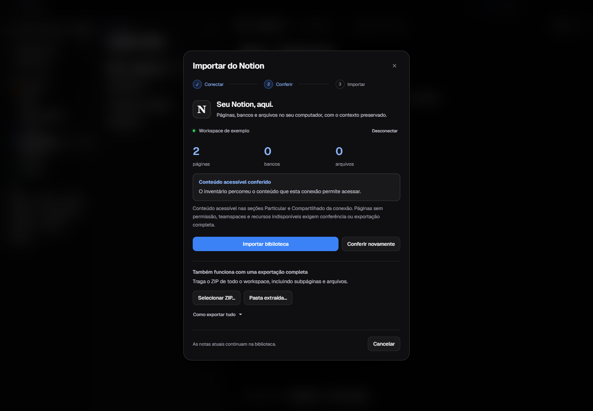
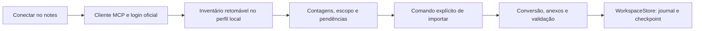

# Migração do Notion

O notes oferece conexão direta com o Notion e importação de exportações em ZIP ou pasta. O objetivo é reduzir etapas manuais, conferir o que foi recebido e preservar a origem antes de acrescentar notas à biblioteca.

## Usar a conexão direta

1. Abra **Arquivo → Importar do Notion**, a busca `Ctrl+K` ou Configurações.
2. Clique em **Conectar ao Notion** e autorize o notes na página oficial aberta no navegador. Não é preciso criar uma integração, copiar um token ou configurar um servidor.
3. Aguarde o inventário. Ele enumera as raízes disponíveis em Particular e Compartilhado, segue páginas e bancos, consulta registros e tenta preservar os arquivos acessíveis.
4. Confira as contagens e eventuais pendências. **Conteúdo acessível conferido** se refere ao escopo da conexão; páginas sem permissão e teamspaces exigem conferência adicional.
5. Clique em **Importar biblioteca**. Se houver pendências, a ação se chama **Importar conteúdo encontrado**, para deixar explícito que a origem ainda precisa de conferência.

O inventário não acrescenta notas ao workspace. O aplicativo prepara o conteúdo e salva a biblioteca pelo armazenamento transacional somente após o comando de importar. Fechar a janela ou interromper a leitura conserva o inventário para retomada. Uma gravação já iniciada termina antes de fechar.

O relatório oferece atalhos para abrir cada página ou tabela. A biblioteca existente continua disponível, e os dados importados não são enviados imediatamente ao GitHub. Valem as mesmas regras de sincronização diária ou manual das demais notas.



Captura da interface real com respostas sintéticas dos testes, sem dados de uma conta pessoal.

## Conferir a cobertura

Conexão autorizada não comprova acesso a todo o workspace. O notes registra o escopo `accessible-private-shared` e mantém `workspaceComplete: false`; não usa os primeiros resultados de uma busca como prova de completude.

| Situação | Comportamento |
| --- | --- |
| Raízes com cursor | Percorre as páginas da listagem e detecta cursores repetidos. |
| Banco com registros | Lê primeiro o esquema; usa os modos de consulta disponibilizados pela sessão. |
| Limite de registros, cota ou permissão | Preserva o conteúdo recebido e apresenta uma pendência. |
| Página truncada ou blocos desconhecidos | Tenta recuperar referências expostas e sinaliza conteúdo que continua ausente. |
| Comentários indisponíveis ou incompletos | Guarda o que foi recebido e registra a limitação. |
| Arquivo expirado, externo ou acima do limite | Preserva a referência e informa que os bytes não foram confirmados localmente. |
| Teamspaces ou páginas fora da conexão | Exige conferência na origem ou uma exportação completa. |

Visualizações filtradas, permissões, histórico de versões, automações e recursos próprios do Notion não são recriados como funcionalidades do notes. Propriedades, texto, referências e registros técnicos recebidos são preservados na representação local e nos arquivos da importação. A apresentação pode mudar ao converter blocos para o editor visual.

Referências estáveis de arquivos recebem um endereço novo na retomada. Um endereço temporário embutido em propriedades ou capas pode expirar durante inventários longos; nesse caso, use **Iniciar nova verificação** para renovar a leitura da origem ou complemente pelo ZIP completo. O arquivo continua marcado como pendente até seus bytes serem preservados.

## Usar uma exportação completa

No Notion, abra **Configurações → Workspace → Geral → Exportar todo o conteúdo do workspace**. Escolha HTML ou Markdown e CSV, incluindo subpáginas e arquivos quando essas opções estiverem disponíveis. Depois selecione **Selecionar ZIP…** ou **Pasta extraída…** no notes.

Um ZIP exportado de uma página isolada contém apenas aquela parte da biblioteca. O aplicativo consegue converter seus arquivos, mas não consegue reconstruir páginas que o Notion não incluiu. Compare as contagens e abra algumas páginas e tabelas antes de considerar a migração concluída.

Exportações ZIP repetidas criam grupos independentes. Repetir a aplicação da mesma revisão do inventário conectado é idempotente: o marcador `notionMigrationId` evita criar novamente o grupo já salvo. Quando a retomada encontra novos itens, eles são acrescentados ao mesmo grupo, preservando as notas existentes. Alterações da origem em uma nota já importada exigem conferência e não sobrescrevem a edição local. Uma nova verificação inicia outro inventário.

As regras de segurança, limites de arquivos e preservação dos originais da importação por ZIP estão no [guia de uso](GUIA.md#importar-do-notion-e-obsidian). ZIPs internos também são processados dentro dos limites do importador.

## Arquitetura e privacidade



| Componente | Responsabilidade |
| --- | --- |
| [notion-client.cjs](../desktop/notion-client.cjs) | Descoberta OAuth, registro de cliente público, PKCE S256, retorno local, renovação e transporte MCP HTTP. |
| [notion-migration.cjs](../desktop/notion-migration.cjs) | Enumeração, plano persistido, consultas, arquivos, cobertura e preparação da importação. |
| [notion-content.cjs](../desktop/notion-content.cjs) | Conversão do Markdown enriquecido do Notion e leitura de referências/metadados. |
| [importers.cjs](../desktop/importers.cjs) | Conversão local e preservação dos arquivos preparados, compartilhada com a importação ZIP. |
| [main.cjs](../desktop/main.cjs) e [preload.cjs](../desktop/preload.cjs) | IPC restrito, cancelamento, exclusão mútua e gravação no armazenamento. |
| [notion-import.jsx](../src/notion-import.jsx) | Conexão, inventário, aviso de cobertura e alternativa por ZIP. |

A autorização usa o serviço oficial `https://mcp.notion.com`, OAuth com PKCE e cliente nativo público. Não usa um backend do autor nem reaproveita a autorização do Codex. As chamadas são restritas a ferramentas de leitura; não há comando para alterar o workspace de origem.

Credenciais ficam em `notes-data/notion-credentials.enc`, cifradas pela proteção do sistema operacional. Não entram no renderer, nas notas, no Git ou nos backups da biblioteca. Sem proteção disponível, o login falha explicitamente. Transportar o arquivo cifrado não autoriza outro computador.

Planos e downloads temporários ficam em `notes-data/notion-import/`, separados das revisões do workspace. Esses arquivos contêm material privado recebido do Notion e precisam dos mesmos cuidados que a biblioteca local. A importação guarda registros técnicos necessários à conferência; endereços temporários de download são retirados dos registros arquivados. Desconectar remove a autorização local; não apaga as notas importadas.

Arquivos são baixados apenas de endereços HTTPS permitidos dos serviços de arquivos do Notion, sem encaminhar o bearer da conexão. Redirecionamentos são conferidos, tamanhos são limitados e os bytes recebem SHA-256 antes da conversão local. Arquivos externos permanecem como referências quando não podem ser baixados por esse caminho.

## Verificação reproduzível

```powershell
node --test tests/notion-client.test.cjs tests/notion-migration.test.cjs tests/importers.test.cjs
npm run test:notion-ui
```

Os testes usam contas e respostas sintéticas, perfis temporários e o Electron real. Exercitam OAuth/PKCE com transporte controlado, paginação, limites, cancelamento, retomada, preservação, repetição da mesma aplicação e persistência. Não fazem registro de cliente, login real nem leitura da conta pessoal durante QA.

A aceitação do retorno local e as permissões de uma conta real dependem do provedor e precisam ser verificadas no uso autorizado. Os testes locais não equivalem a uma migração executada de todo o workspace do usuário. Consulte os resultados efetivamente executados em [Validação](VALIDACAO.md).

## Referências oficiais

- [Cliente MCP do Notion e autenticação](https://developers.notion.com/guides/mcp/build-mcp-client).
- [Ferramentas MCP e limites por plano](https://developers.notion.com/guides/mcp/mcp-supported-tools).
- [Exportar conteúdo do Notion](https://www.notion.com/help/export-your-content).
- [Autorização no protocolo MCP](https://modelcontextprotocol.io/specification/2025-11-25/basic/authorization).
